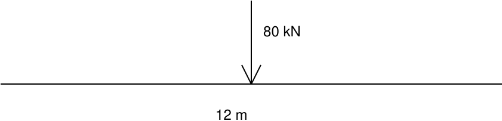

## BRIDGE TEST - reference fixture

Table 1. Design loads (KN). Keep row and column associations.

| Member   |   Service (KN) |   Ultimate (KN) |
|----------|----------------|-----------------|
| Beam A   |          125.5 |          188.25 |
| Beam B   |          240.0 |           360.0 |

Figure 1. Simply supported beam, span 12 m, load 80 KN.

"ULUN|OD Ya] 8Yy} SPUS Y1AG YAGHO "ULUNJOD Yo] BY} SUBIS WHd IV YAGHO

"jy6u spus Y¥174d0 YAGHO "Wy6u sues VWAWVS YSCYHO