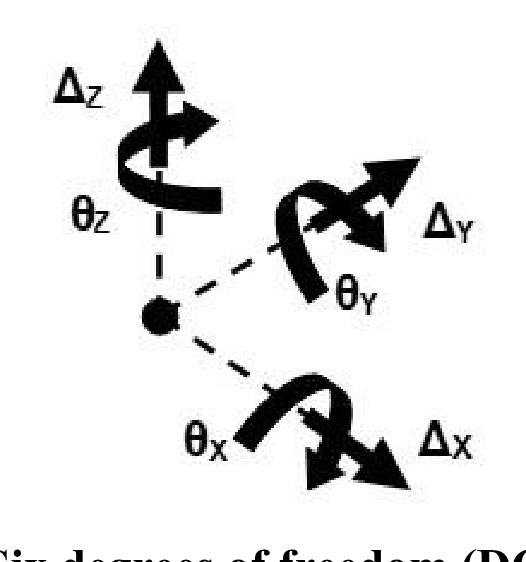
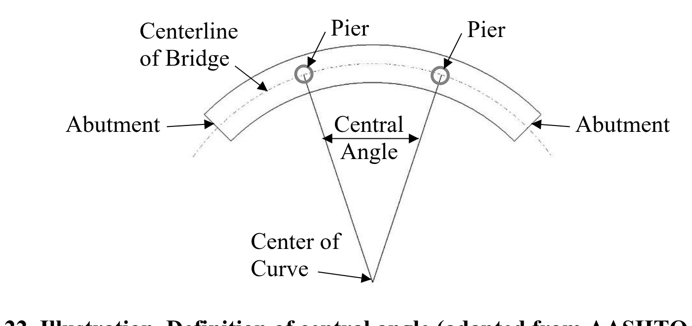
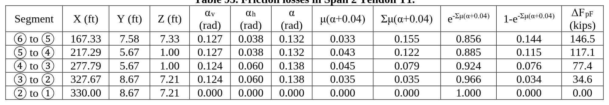
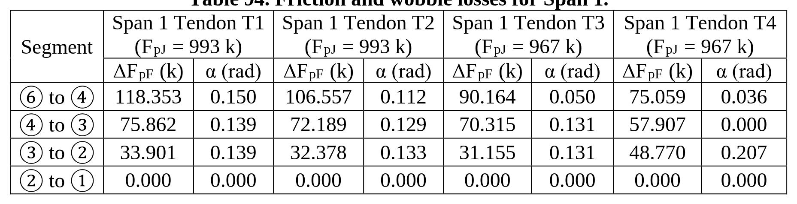
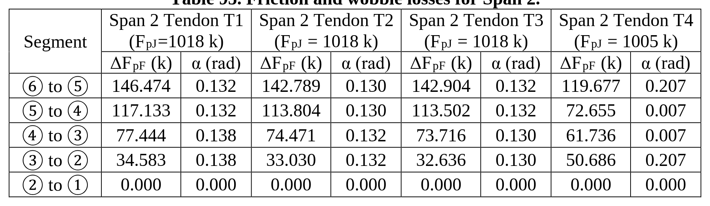

<!-- page 1 -->

used for more than just structural analysis and design. The models will be part of the database of information about the bridge and can be used to aid in other tasks downstream of design, such as fabrication, construction, and operation.

# 2.3.2 Gauss Points, Shape Functions and Degrees of Freedom

The finite element method is a numerical matrix solution technique for finding approximate solutions to boundary value problems. The method entails using a series of elements to approximate a continuum. Individual elements use polynomial functions called shape functions to describe the deflected shape between the element connections, or nodes. For a given level of meshing, the more accurately the shape functions approximate the actual deflected shape, the better the agreement with the actual behavior.

Integration is used to calculate the element stiffnesses as well as for element state determination (e.g., recovery of element internal stresses and nodal forces for a given set of element displacements). The integration proceeds by evaluating the function at specific points, applying an appropriate weighting factor, and summing results. Gauss numerical integration, or Gaussian Quadrature, is the most commonly used technique in generating element matrices. This technique minimizes internal integration points and locates them so as to minimize integration error when the integrand is a general polynomial. Systematically combining all of the individual elements into a global system of equations leads to the solution of the overall model. Often finite element programs provide output at the gauss points of elements as well as the nodes. For further information on the finite element method, see texts such as (Bathe, 1976) and (Zienkiewicz, 2005).

Displacements of a point, or node, can be characterized with up to six quantities in Cartesian coordinates: translation and rotation for each of the three axes, as illustrated in Figure 1. The possible movements of a node due to the structure loading are referred to as degrees of freedom (DOF). The DOF of a model corresponds to the sum of all the DOF at all the nodes in the model, although not all finite elements incorporate all six DOF at the nodes in their formulations. For instance, members modeled using truss elements that do not incorporate rotational degrees of freedom can have incompatible rotations at connecting nodes. Another example would be two dimensional planar elements that do not incorporate out-of-plane DOF. Generally the more DOF in a model, the more computational effort is required to solve the equations. For example a truss modeled as pin-connected using two force bar elements will require less computational effort than the same truss modeled using beam elements with full fixity at the joints.

> **Figure 1** · image · p. 1 : Figure 1. Illustration. Six degrees of freedom (DOF) at a point, or node.
>
> *texte de l'image non extractible du PDF : voir l'image*

<!-- page 2 -->

o Arc length of the girder for simple spans o 0.9 times the arc length for end spans of continuous members o 0.8 times the arc length for interior spans of continuous members

For box girders:

- Girders are concentric
- Bearing lines are not skewed
- The girder depth is less than the width of the box at mid-depth
- For all spans, the arc span divided by the girder radius in feet is less than 0.3 radians, where the arc span Las, is taken as:

o Arc length of the girder for simple spans o 0.9 times the arc length for end spans of continuous members o 0.8 times the arc length for interior spans of continuous members

The AASHTO LRFD gives some guidance on modeling curved spine beams. Multiple straight elements can be used to approximate the curvature of curved structures in plan. AASHTO LRFD Article 4.6.1.2.2 applies to horizontally curved torsionally stiff single girder superstructures except concrete box girders.

For concrete box girders, Article 4.6.1.2.3 of the AASHTO LRFD states that horizontally curved concrete box girders may be designed with straight segments, for central angles (see Figure 22) up to 12 degrees within one span, unless concerns about other force effects dictate otherwise. It also states that horizontally curved nonsegmental concrete box girder bridge superstructures may be analyzed and designed for global force effects as single-spine beams with straight segments, for central angles up to 34 degrees within one span.

> **Figure 2** · dessin · p. 2 : Figure 22. Illustration. Definition of central angle (adapted from AASHTO, 2014).
>
> *Texte dans la figure :* Centerline Pier Pier · of Bridge · Abutment Central Abutment · Angle · Center of · Curve

Article 4.6.1.2.3 of AASHTO LRFD also states that horizontally curved segmental concrete box girder superstructures meeting the requirements of AASHTO LRFD Article 4.6.1.1, and whose central angle within one span is between 12 degrees and 34 degrees may be analyzed as a single-spine beam comprised of straight segments provided no segment has a central angle greater than 3.5 degrees as shown in Figure 23. For both segmental and non-segmental box girder bridges with central angles exceeding 34 degrees within any one span, or for bridges with a maximum

45

<!-- page 3 -->

**Table 93. Friction losses in Span 2 Tendon T1.**

| Segment | X (ft) | Y (ft) | Z (ft) | αv (rad) | αh (rad) | α (rad) | μ(α+0.04) | Σμ(α+0.04) | -Σμ(α+0.04) e | -Σμ(α+0.04) 1-e | ΔFpF (kips) |
| --- | --- | --- | --- | --- | --- | --- | --- | --- | --- | --- | --- |
| ⑥ to ⑤ | 167.33 | 7.58 | 7.33 | 0.127 | 0.038 | 0.132 | 0.033 | 0.155 | 0.856 | 0.144 | 146.5 |
| ⑤ to ④ | 217.29 | 5.67 | 1.00 | 0.127 | 0.038 | 0.132 | 0.043 | 0.122 | 0.885 | 0.115 | 117.1 |
| ④ to ③ | 277.79 | 5.67 | 1.00 | 0.124 | 0.060 | 0.138 | 0.045 | 0.079 | 0.924 | 0.076 | 77.4 |
| ③ to ② | 327.67 | 8.67 | 7.21 | 0.124 | 0.060 | 0.138 | 0.035 | 0.035 | 0.966 | 0.034 | 34.6 |
| ② to ① | 330.00 | 8.67 | 7.21 | 0.000 | 0.000 | 0.000 | 0.000 | 0.000 | 1.000 | 0.000 | 0.00 |

**Table 94. Friction and wobble losses for Span 1.**

<table>
<tr><th rowspan="2">Segment</th><th colspan="2">Span 1 Tendon T1 (FpJ = 993 k)</th><th colspan="2">Span 1 Tendon T2 (FpJ = 993 k)</th><th colspan="2">Span 1 Tendon T3 (FpJ = 967 k)</th><th colspan="2">Span 1 Tendon T4 (FpJ = 967 k)</th></tr>
<tr><td>ΔFpF (k)</td><td>α (rad)</td><td>ΔFpF (k)</td><td>α (rad)</td><td>ΔFpF (k)</td><td>α (rad)</td><td>ΔFpF (k)</td><td>α (rad)</td></tr>
<tr><td>⑥ to ④</td><td>118.353</td><td>0.150</td><td>106.557</td><td>0.112</td><td>90.164</td><td>0.050</td><td>75.059</td><td>0.036</td></tr>
<tr><td>④ to ③</td><td>75.862</td><td>0.139</td><td>72.189</td><td>0.129</td><td>70.315</td><td>0.131</td><td>57.907</td><td>0.000</td></tr>
<tr><td>③ to ②</td><td>33.901</td><td>0.139</td><td>32.378</td><td>0.133</td><td>31.155</td><td>0.131</td><td>48.770</td><td>0.207</td></tr>
<tr><td>② to ①</td><td>0.000</td><td>0.000</td><td>0.000</td><td>0.000</td><td>0.000</td><td>0.000</td><td>0.000</td><td>0.000</td></tr>
</table>

**Table 95. Friction and wobble losses for Span 2.**

<table>
<tr><th rowspan="2">Segment</th><th colspan="2">Span 2 Tendon T1 (FpJ=1018 k)</th><th colspan="2">Span 2 Tendon T2 (FpJ = 1018 k)</th><th colspan="2">Span 2 Tendon T3 (FpJ = 1018 k)</th><th colspan="2">Span 2 Tendon T4 (FpJ = 1005 k)</th></tr>
<tr><td>ΔFpF (k)</td><td>α (rad)</td><td>ΔFpF (k)</td><td>α (rad)</td><td>ΔFpF (k)</td><td>α (rad)</td><td>ΔFpF (k)</td><td>α (rad)</td></tr>
<tr><td>⑥ to ⑤</td><td>146.474</td><td>0.132</td><td>142.789</td><td>0.130</td><td>142.904</td><td>0.132</td><td>119.677</td><td>0.207</td></tr>
<tr><td>⑤ to ④</td><td>117.133</td><td>0.132</td><td>113.804</td><td>0.130</td><td>113.502</td><td>0.132</td><td>72.655</td><td>0.007</td></tr>
<tr><td>④ to ③</td><td>77.444</td><td>0.138</td><td>74.471</td><td>0.132</td><td>73.716</td><td>0.130</td><td>61.736</td><td>0.007</td></tr>
<tr><td>③ to ②</td><td>34.583</td><td>0.138</td><td>33.030</td><td>0.132</td><td>32.636</td><td>0.130</td><td>50.686</td><td>0.207</td></tr>
<tr><td>② to ①</td><td>0.000</td><td>0.000</td><td>0.000</td><td>0.000</td><td>0.000</td><td>0.000</td><td>0.000</td><td>0.000</td></tr>
</table>

<!-- page 4 -->

# APPENDIX 2A – REFERENCES TO REFINED ANALYSIS IN AASHTO LRFD

List of references to refined analysis found in the 7 PthP Edition of AASHTO LRFD.

Keywords such as "analysis", "methods", "software", and "finite" were used.

| ARTICLE | CONTEXT |  |  |  |  |  | ADDITIONAL GUIDANCE PROVIDED |
| --- | --- | --- | --- | --- | --- | --- | --- |
| 2.5.2.6.1 | If dynamic analysis is used to determine deformations, it shall comply with Article 4.7. | - | - | X | X | X | Reference to Article 4.7 (See below). |
| 3.4.1 | If refined analysis is used for concrete substructures, use 1.0 for gRTUR with a partially cracked moment of inertia. | - | X | X | X | X | Use partially cracked moment of inertia for thermal loadings of concrete substructures. |
| 3.6.1.4.3a | Where the bridge is analyzed by any refined method, as specified in Article 4.6.3, a single design truck shall be positioned transversely and longitudinally to maximize stress range at the detail under consideration. | X | - | X | X | X | Position of design truck. |
| Table 3.10.3.2-1 | Site-specific geotechnical investigation and dynamic site response analysis should be performed for all sites in Site Class F. | - | X | - | X | - | - |
| 4.1 | States that methods of analysis based on documented material characteristics that satisfy equilibrium and compatibility, including inelastic analyses, may be used. | - | - | X | X | - | - |
| C4.1 | States that the limitations and assumptions of refined and complex analyses are described in this section. | - | - | X | X | - | - |
| 4.4 | Bulleted list of acceptable methods for structural analysis. | - | - | X | X | - | - |
| C4.4 | Warns the reader to be aware of assumptions embedded in computer program code. Also provides some verification methods. | - | - | X | X | X | Suggests some verification methods for computer programs. |

FORCE EFFECTS? SECTION EFFECTS? FEA CANDIDATE? OTHER REFINED ANALYSIS? GUIDANCE FOR FEA?
