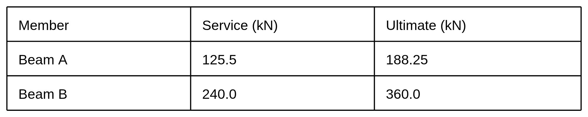

<!-- page 1 -->

# BRIDGE TEST - reference fixture

Table 1. Design loads (kN). Keep row and column associations.

| Member | Service (kN) | Ultimate (kN) |
| --- | --- | --- |
| Beam A | 125.5 | 188.25 |
| Beam B | 240.0 | 360.0 |

Figure 1. Simply supported beam, span 12 m, load 80 kN.

80 kN

12 m

ORDER\_ALPHA starts the left column. ORDER\_GAMMA starts right.

ORDER\_BETA ends the left column. ORDER\_DELTA ends right.
