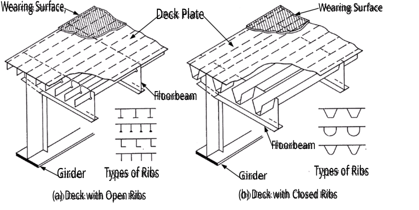
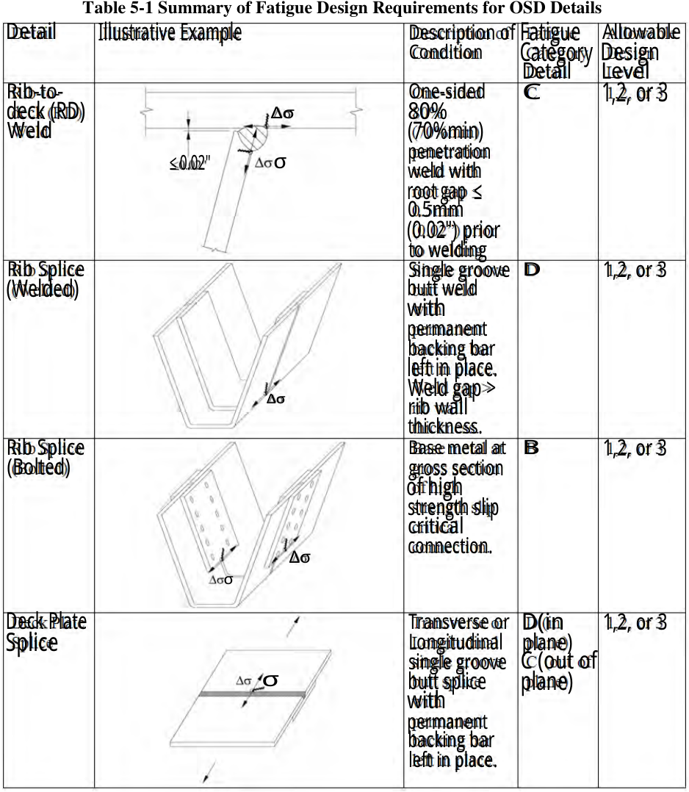
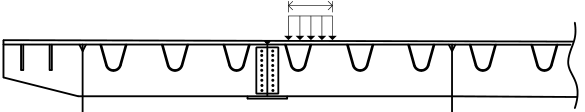

<!-- Start of picture text -->
Wearing Surface, Wearing Surface Deck Plate Floorbeam Floorbeam Girder Types of Ribs Girder Types of Ribs (a) Deck with Open Ribs (b) Deck with Closed Ribs <!-- End of picture text -->

# **Figure 1-1 Components of the Orthotropic Steel Deck Bridge Girder System showing (a) Open Ribs and (b) Closed Ribs (AISC, 1963. Copyright American Institute of Steel Construction Reprinted with permission. All rights reserved.)** 

The OSD system has been utilized successfully for thousands of bridges worldwide, particularly 

in Europe, Asia, and South America. The United States has not yet fully embraced this technology, with only an estimated 100 such bridges in its inventory. The OSD bridge has been most commonly used in the United States for particular design conditions.  One condition is for long span structures where the minimization of dead load is paramount, such as the new Tacoma Narrows Bridge.  A second example is for box girders which contain slender compressive plate elements requiring stiffening, such as the Alfred Zampa Memorial Bridge (see Figure 1-2) A third example is for redecking of existing major bridges on urban arterials where rapid construction is needed, such as the Bronx-Whitestone Bridge. 

OSD construction also has tremendous potential for use in short to medium span “workhorse” girder bridges when located on a high-volume roadway where accelerated construction or extended service life is required.  There is a recent trend in the United States towards using bridge systems that are more rapidly constructible to minimize impacts to the traveling public, and to solutions that offer more long term durability and economy with the goal of 100 years of service life (Mistry and Mangus, 2006). The OSD bridge can provide an economical solution to meet these criteria.  Furthermore, OSD is able to be constructed quickly because most of the components are prefabricated. Additionally, complete future redecking is rendered unnecessary, which minimizes any major traffic impacts in the future.  Furthermore, the OSD provides a smooth continuous riding surface durable against deicing salts with minimal joints to prevent leakage and protect the other bridge components. 

5 

**Table 4-1 Orthotropic Steel Deck Deformation Mechanisms** 

|System|Action|Figure|Result|
|---|---|---|---|
|1|Local Deck Plate Deformation|N·N|Transverse flexural stress in deck and rib plates and RD|
|2|Panel Deformation|w4 1|Transverse deck stress from rib differential displacements|
|3|Rib Longitudinal Flexure|in fF fr|Longitudinal flexure and shear in rib acting as a continuous beam on flexible FB supports|
|4|FloorbeamIn- planeFlexure||Flexure and shear in FB acting as beam spanning between rigid girders|
|5|Floorbeam Distortion|Ohaplisagm bononi of ab cnvsruge at Diaphragm curvature betweeni nhe| Out-of-plane flexure ofFB web at rib due to rib rotation|
|6|Rib Distortion||Local flexure ofrib wall due to FB cut-out|
|7|Global||Axial, flexural, and shear stresses from supporting girder deformations|

# **4.2.1. Local Deck Plate Deformation – System 1** 

Load distribution begins with transfer of local wheel loads from the deck plate to the supporting rib walls. The response is influenced by the spacing of the rib walls and relative thickness (flexural stiffness) of the deck plate and ribs. It is noted that the stresses generated from this mechanism are localized and thus sensitive to the size of the wheel patch load and any load dispersion that may occur through the wearing surface. Very often, it is the front axle of the design truck with only a single tire that can maximize response from this mechanism. It is also noted that this system is one driving factor in the fatigue of the RD, but is generally not a concern for strength based limit states. Simplified analysis of System 1 stresses can be accomplished by employing a finite strip (frame) model of the OSD cross-section in the transverse direction with assumed rigid supports for the ribs, or elastic flexible supports based on the rib flexural stiffness and span length. 

31 

<!-- Start of picture text -->
Table 5-1 Summary of Fatigue Design Requirements for OSD Details Detail Illustrative Example Description of Fatigue Allowable Condition Category Design Detail Level Rib-to- One-sided C 1,2, or 3 deck (RD) Δσ 80% Weld (70%min) penetration ≤0.02" �σ weld with root gap ≤ 0.5mm (0.02") prior to welding Rib Splice Single groove D 1,2, or 3 (Welded) butt weld with permanent backing bar left in place. Δσ Weld gap >rib wall thickness. Rib Splice Base metal at B 1,2, or 3 (Bolted) gross section of high strength slip critical connection. Δσ �σ Deck Plate Transverse or D(in 1,2, or 3 Splice Longitudinal plane) single groove C (out of �σ butt splice plane) with permanent backing bar left in place. <!-- End of picture text -->

99 

**Table 11-3 Summary of Fatigue Checks for Example 1** 

|Detail|Point of interest|Sr (MPa)|Sr,allow (MPa)|
|---|---|---|---|
|RD (Deck)|Deck at rib connection directly under load mid-span between FBs.|55.9|69.0|
|RD (Rib)|Rib at deck connection opposite of loaded side mid-span between FBs.|33.9|69.0|
|Rib Spice (Max)|Lowest point of rib at 0.3 of the span between FBs.|343|480|
|Rib Spice (Min)|Lowest point of rib at 0.3 of the span between FBs.|.|.|
|Deck Plate Splice|Deck splice midway between ribs at mid-span between FBs.|40.0|69.0|
|RF (Rib)|Lower half of rib at FB connection|39.5|69.0|
|RF (FB.)|FB at rib-to-deck connection and at base of rib|28.3|69.0|

# **_11.1.6.1. Rib-to-Deck (RD) Weld_** 

To get the maximum stress range in the rib-to-deck weld (RD), a single static loading of one rear wheel patch is applied. The wheel load is centered on one leg of a rib, as illustrated in Figure 11-16, and applied at mid-span of the panel between FBs (note the width of the wheel patch is shown, not the distribution of the load through the wearing surface and one half of the deck plate). A schematic showing the longitudinal position of the loading is shown in Figure 11-17. The locations of interest are the deck plate at the rib connection directly under the load, and the rib at the deck connection in the rib leg opposite the load (see Figure 11-18 and Figure 11-19). 

## 510 mm10 mm 

**Figure 11-16 Transverse Wheel Location to Produce the Largest Impact on the Rib-to-deck Weld** 

212 

